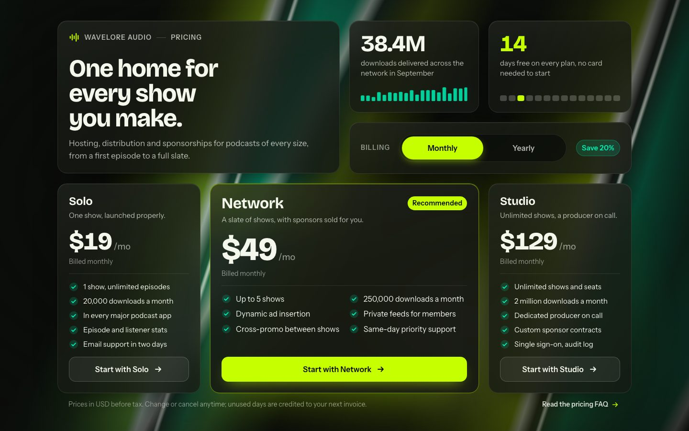
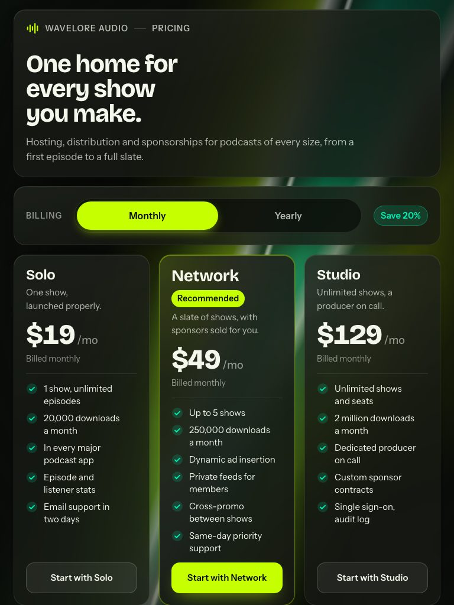
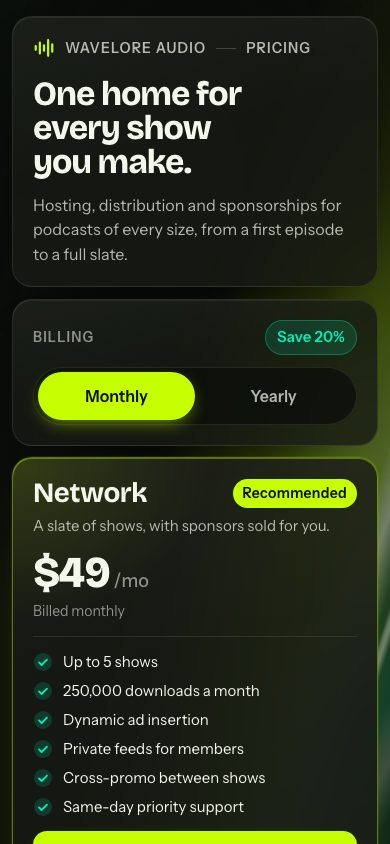
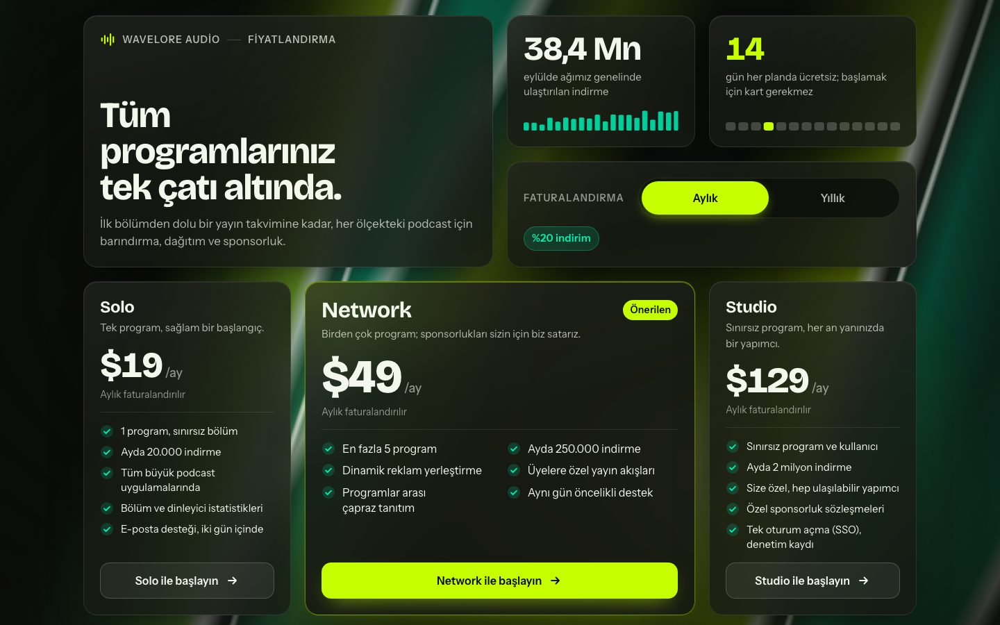
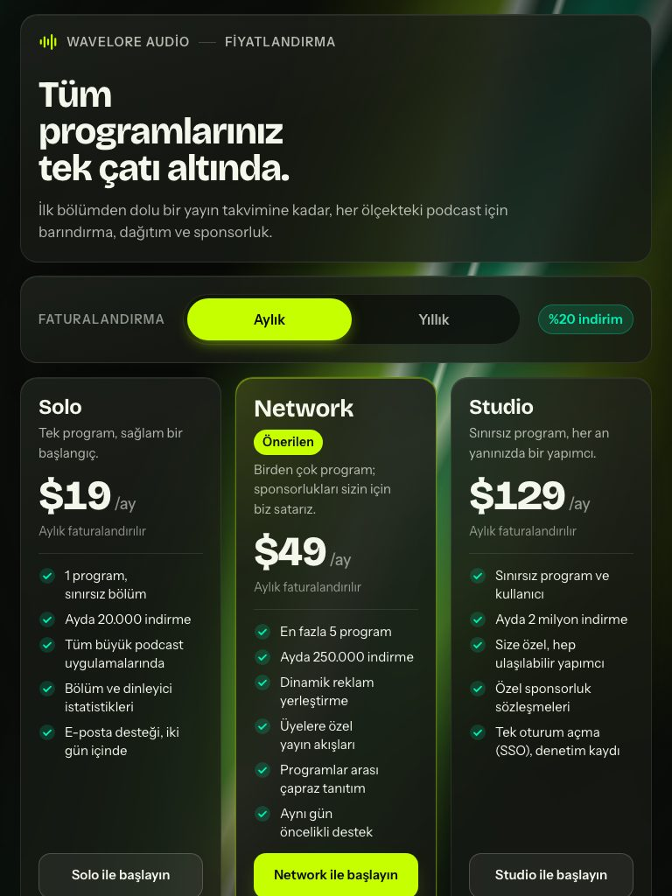

# Liquid Chrome Bento Pricing

A podcast network's pricing as a keynote-style bento rack: a tall headline hero, two square numeral tiles with mini-visuals, a wide billing toolbar and three plan tiles with the recommended plan twice as wide. Prices roll to their yearly amount when the billing thumb springs across, and the checkout button morphs through loading into a mint confirmation that hands off to payment. Behind it, iridescent chrome bands slide and slowly shift hue. Fully responsive, keyboard-first, with every string in the HTML for translation.

**Live demo:** [English](https://exodus-ui-lab.github.io/liquid-chrome-bento-pricing/) · [Türkçe](https://exodus-ui-lab.github.io/liquid-chrome-bento-pricing/tr/)



| Tablet — 768 px | Mobile — 390 px |
|:---:|:---:|
|  |  |

## Highlights

- Bento rack of 2x2, 1x1, 2x1 and 1x2 tiles with a staggered entrance
- Chrome specular on each tile's border follows the pointer
- Billing thumb springs across while every price rolls to its new amount
- Feature list swaps in place for a mint receipt and a Continue to payment link
- Liquid chrome bands with hard specular edges slide behind the grid

## What's inside

| Folder | Contents |
|---|---|
| `frontend/` | The section in English: vanilla HTML, CSS and JavaScript, no build step |
| `frontend-tr/` | The same section in Turkish (identical code, translated copy) |
| `backend/` | The API the section calls: Node.js + Hono, with tests |
| `docs/` | The live demo site (GitHub Pages); the API is answered from example responses |

## Run it locally

### Frontend

Serve `docs/` for the demo with example API responses, or serve `frontend/` and run the backend below for real ones:

```bash
npx serve docs      # demo with example responses
npx serve frontend  # the UI; start the backend for live data
```

### Backend

```bash
cd backend
npm install
npm test
npm start
```

Configuration and details: [backend/README.md](backend/README.md).

## API

The section talks to these endpoints (example responses from the demo):

### `GET /api/plans`

Example response (`200`):

```json
{
  "currency": "USD",
  "yearlySavingsPercent": 20,
  "plans": [
    {
      "id": "solo",
      "recommended": false,
      "prices": {
        "monthly": 1900,
        "yearly": 18000
      }
    },
    {
      "id": "network",
      "recommended": true,
      "prices": {
        "monthly": 4900,
        "yearly": 46800
      }
    }
  ]
}
```

### `POST /api/checkout-session`

Example response (`201`):

```json
{
  "ok": true,
  "sessionId": "cs_wl_9k2fd7qa",
  "planId": "network",
  "interval": "yearly",
  "amountCents": 46800,
  "currency": "USD",
  "expiresAt": "2026-10-02T10:30:00.000Z",
  "checkoutUrl": "/checkout/cs_wl_9k2fd7qa",
  "message": "Nothing is charged until your 14 free days end."
}
```

_Long lists and strings are shortened here._

Full contract: [backend/CONTRACT.md](backend/CONTRACT.md).

## License

MIT © 2026 Exodus Yazılım. See [LICENSE](LICENSE).

"Wavelore Audio" is a fictional brand; every name, company and quote in the demo is made up.

---

## Türkçe

### Sıvı Kromlu Bento Fiyatlandırma

Bir podcast ağının fiyatlandırması, lansman sahnesi tadında bir bento vitrini olarak: uzun bir başlık alanı, mini görselli iki kare rakam kutusu, geniş bir faturalandırma çubuğu ve önerilen planın iki kat geniş olduğu üç plan kutusu. Faturalandırma düğmesi yaylanarak kaydığında fiyatlar yıllık tutarlarına doğru akar; ödeme düğmesi yükleme durumundan geçip ödeme sayfasına yönlendiren nane yeşili bir onaya dönüşür. Arka planda yanardöner krom şeritler kayar ve renk tonu yavaşça değişir. Tamamen duyarlı, klavyeyle eksiksiz kullanılabilir ve arayüzdeki tüm metinler HTML'de toplanmıştır.

**Canlı demo:** [Türkçe](https://exodus-ui-lab.github.io/liquid-chrome-bento-pricing/tr/) · [English](https://exodus-ui-lab.github.io/liquid-chrome-bento-pricing/)



| Tablet — 768 px | Mobil — 390 px |
|:---:|:---:|
|  |  |

#### Öne çıkanlar

- Kademeli girişle beliren 2x2, 1x1, 2x1 ve 1x2 boyutlu bento kutuları
- Her kutunun kenarındaki krom parıltı imleci takip eder
- Faturalandırma düğmesi kayarken tüm fiyatlar yeni tutarlarına akar
- Özellik listesi yerinde nane yeşili bir onaya ve Ödemeye geçin bağlantısına dönüşür
- Keskin parıltılı sıvı krom şeritler ızgaranın arkasında süzülür

#### İçerik

| Klasör | Ne var |
|---|---|
| `frontend/` | Bölümün İngilizce hâli: sade HTML, CSS ve JavaScript, derleme adımı yok |
| `frontend-tr/` | Aynı bölümün Türkçe hâli (kod aynı, metinler çevrildi) |
| `backend/` | Bölümün çağırdığı API: Node.js + Hono, testleriyle birlikte |
| `docs/` | Canlı demo sitesi (GitHub Pages); API örnek yanıtlarla cevaplanır |

#### Yerelde çalıştırma

##### Frontend

Örnek API yanıtlarıyla demo için `docs/` klasörünü, gerçek yanıtlar için `frontend-tr/` klasörünü sunup aşağıdaki backend’i çalıştırın:

```bash
npx serve docs         # örnek yanıtlarla demo
npx serve frontend-tr  # arayüz; canlı veri için backend’i başlatın
```

##### Backend

```bash
cd backend
npm install
npm test
npm start
```

Ayarlar ve ayrıntılar: [backend/README.md](backend/README.md).

#### API

Bölümün kullandığı uç noktalar (demodaki örnek yanıtlar):

##### `GET /api/plans`

Örnek yanıt (`200`):

```json
{
  "currency": "USD",
  "yearlySavingsPercent": 20,
  "plans": [
    {
      "id": "solo",
      "recommended": false,
      "prices": {
        "monthly": 1900,
        "yearly": 18000
      }
    },
    {
      "id": "network",
      "recommended": true,
      "prices": {
        "monthly": 4900,
        "yearly": 46800
      }
    }
  ]
}
```

##### `POST /api/checkout-session`

Örnek yanıt (`201`):

```json
{
  "ok": true,
  "sessionId": "cs_wl_9k2fd7qa",
  "planId": "network",
  "interval": "yearly",
  "amountCents": 46800,
  "currency": "USD",
  "expiresAt": "2026-10-02T10:30:00.000Z",
  "checkoutUrl": "/checkout/cs_wl_9k2fd7qa",
  "message": "14 günlük ücretsiz deneme süreniz bitene kadar hiçbir ücret alınmaz."
}
```

_Uzun listeler ve metinler burada kısaltıldı._

Sözleşmenin tamamı: [backend/CONTRACT.md](backend/CONTRACT.md).

#### Lisans

MIT © 2026 Exodus Yazılım. Ayrıntılar için [LICENSE](LICENSE).

"Wavelore Audio" hayali bir markadır; demodaki tüm isimler, şirketler ve alıntılar kurgudur.

---

[Exodus Yazılım](https://exodusyazilim.com)
